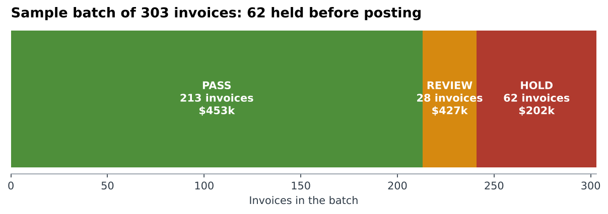
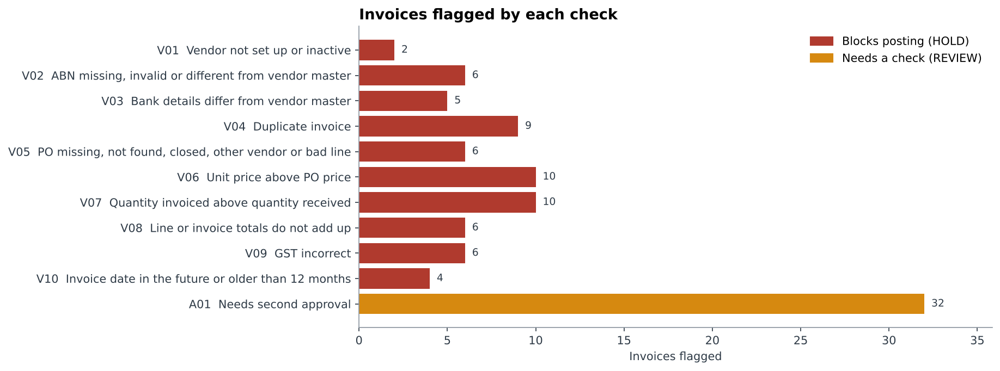
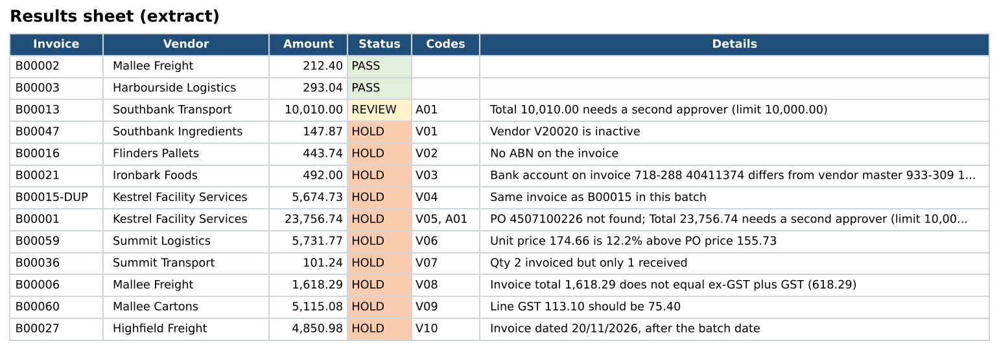
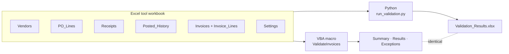
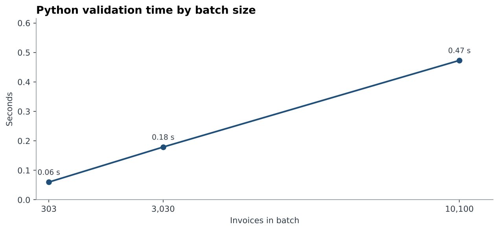

# Invoice Validation Automation (Excel VBA + Python)


A pre-posting check for a day's batch of supplier invoices. Every invoice is checked against the vendor master, the purchase order, the goods receipt and the posted-invoice history, then marked **PASS**, **REVIEW** or **HOLD** with the reason in plain English.

In accounts payable at Corteva Agriscience I automated invoice validation in Excel VBA, which cut a check that took about 40 minutes by hand to about 5 minutes. This project rebuilds that idea from scratch with dummy data and takes it further. There are 11 checks, and the same logic is written twice:

- **an Excel VBA macro**, for AP teams who work in Excel (runs on Windows and Mac), and
- **a Python script**, for batches too large for Excel.

Both versions are checked automatically to give identical results.



## Key results

| | Sample batch |
|---|---|
| Invoices checked | **303** invoices, 480 lines, **$1.08M** inc GST |
| Outcome | **213 PASS** ($453k) · **28 REVIEW** ($427k) · **62 HOLD** ($202k) |
| Accuracy | All **64 planted problems caught**, and **no invoice held without a reason** |
| VBA vs Python | **Identical** output: 303 result rows and 98 exception rows match cell for cell |
| Speed (Python) | 0.06 s for 303 invoices; **0.47 s for 10,100** |

## What it checks

| Code | Check | Action | Why it matters |
|---|---|---|---|
| V01 | Vendor exists and is active | HOLD | Stops payments to suppliers that were closed off |
| V02 | ABN present, passes the ATO checksum, matches the vendor master | HOLD | Invalid tax invoice; possible no-ABN withholding |
| V03 | Bank details on the invoice match the vendor master | HOLD | Payment redirection fraud (fake "new bank details") |
| V04 | Not already posted, and not twice in this batch (number cleaned: `INV-1043` = `INV001043`) | HOLD | Duplicate payments |
| V05 | PO exists, is open, belongs to this vendor, and every invoice line is on the PO | HOLD | "No PO, no pay" |
| V06 | Unit price no more than 2% above the PO price | HOLD | Paying more than agreed |
| V07 | Quantity invoiced not more than quantity received (3-way match) | HOLD | Paying for goods not delivered |
| V08 | Qty × price = line total; lines add up to the invoice totals | HOLD | Keying and supplier arithmetic errors |
| V09 | GST is 10% on taxable lines, nil on GST-free lines, nil from unregistered suppliers | HOLD | Overcharged GST is only recoverable from the supplier |
| V10 | Invoice not dated in the future (HOLD) or more than 12 months ago (REVIEW) | HOLD / REVIEW | Wrong dates and stale claims |
| A01 | Total $10,000 or more | REVIEW | Needs a second approver |

All tolerances live on the **Settings** sheet of the workbook, so a manager can change them without touching code, and both versions read them from there.



Each invoice gets one row with its status, codes and a reason a person can act on:



## How it works



1. **Load** the six input sheets into memory (arrays in VBA, DataFrames in Python).
2. **Build lookups** for vendors, PO lines, receipts and posted invoices, so each check is a fast key lookup instead of a search.
3. **Header checks** per invoice (V01 to V05, V10), then **line checks** (V05 to V09), then **totals and approval** (V08, V09, A01).
4. **Write** one row per invoice to Results and one row per problem to Exceptions, sorted the same way in both versions, plus a Summary.

## Using the Excel tool

1. Open `excel/Invoice_Validation_Tool.xlsx`. It contains the sample batch.
2. Import the macro. Press **Alt+F11** (Mac: **Tools → Macro → Visual Basic Editor**), then **File → Import File** and choose `excel/InvoiceValidation.bas`.
3. Save as **Excel Macro-Enabled Workbook (.xlsm)**.
4. Run **ValidateInvoices** (Developer → Macros). The Summary, Results and Exceptions sheets fill in, and the run time is shown on the Summary sheet.

The macro uses **Collections** for lookups, not `Scripting.Dictionary`, because Dictionary doesn't exist in Excel for Mac.

## Using the Python version

```bash
git clone https://github.com/shameerrazvi/invoice-validation-automation.git
cd invoice-validation-automation
python -m venv .venv
source .venv/bin/activate        # Windows: .venv\Scripts\activate
pip install -r requirements.txt

python run_validation.py                          # validate the sample batch
python run_validation.py --workbook my_batch.xlsx # or your own workbook in the same layout
python build_sample_tool.py                       # regenerate the sample data and workbook
python benchmark.py                               # timing at 300 / 3,000 / 10,000 invoices
pytest                                            # 36 tests
```

The output is `outputs/Validation_Results.xlsx`, with Summary, Results (colour-coded by status), Exceptions and an Exception Codes reference sheet.

## Proving the two versions agree

`tools/check_vba_parity.py` loads the VBA module into a copy of the workbook, runs it in LibreOffice's VBA-compatible engine, and compares its Results and Exceptions sheets with the Python output row by row:

```
Results:    303 Python rows, 303 VBA rows -> IDENTICAL
Exceptions: 98 Python rows, 98 VBA rows -> IDENTICAL
```

Writing the logic twice and checking one against the other caught two real bugs while building this. Excel was turning invoice number `015304` into the number `15304`, and the Python version crashed on a batch with no exceptions at all.

## Speed



| Invoices | Lines | Posted history checked | Time | Invoices per second | Planted problems caught |
|---:|---:|---:|---:|---:|---:|
| 303 | 479 | 2,505 | 0.06 s | 5,021 | 64 of 64 |
| 3,030 | 4,671 | 25,057 | 0.18 s | 16,918 | 642 of 642 |
| 10,100 | 15,811 | 83,504 | 0.47 s | 21,335 | 2,947 of 2,947 |

Python checks about 21,335 invoices a second, and every planted problem is still caught at 10,100 invoices. The VBA version is meant for a normal daily batch of a few hundred invoices inside Excel.

## Testing

- **Rule tests** on a small hand-built batch. Each starts from an invoice that passes every check and changes one thing, including the boundaries: exactly 2% over the PO price passes, 3% is held; a GST difference of 4 cents passes.
- **Sample batch test:** every planted problem is caught, and nothing else is held.
- **ABN tests** for the ATO checksum, plus a check that the Settings sheet reads back correctly. 36 tests in total.

The sample data is synthetic (`src/generate_batch.py`, fixed seed). Planted problems are listed in `data/sample_batch/seeded_issues.csv` and are never read by the checks.

## Project structure

```
invoice-validation-automation/
├── excel/
│   ├── Invoice_Validation_Tool.xlsx   # input sheets, Settings, empty output sheets
│   └── InvoiceValidation.bas          # the VBA macro
├── src/
│   ├── config.py                      # settings, codes
│   ├── validate.py                    # the 11 checks (pandas)
│   ├── workbook.py                    # read the tool, write the results workbook
│   ├── generate_batch.py              # synthetic batch with planted problems
│   ├── abn.py                         # ATO ABN checksum
│   └── charts.py
├── data/sample_batch/                 # the sample batch as CSV + seeded_issues.csv
├── outputs/                           # Validation_Results.xlsx, results.csv, exceptions.csv, benchmark.csv
├── tools/check_vba_parity.py          # runs the VBA in LibreOffice and compares with Python
├── tests/
├── run_validation.py
├── build_sample_tool.py
└── benchmark.py
```

## Limitations and next steps

- **Quantity check is per invoice.** V07 compares this invoice with what was received, but not with quantities *already invoiced* against the same PO line in earlier batches. Next step: track cumulative invoiced quantity per PO line.
- **No credit notes or partial payments** in the sample data.
- **Tolerances are flat.** A per-category tolerance (freight vs fixed-price services) would cut false holds on real data.
- **Next:** read the batch straight from an SAP export, email each vendor's held invoices to the AP officer, and run the Python version on a schedule.

## Author

**Shameer Razvi Mir**, Data & BI Analyst, Melbourne
[LinkedIn](https://www.linkedin.com/in/shameerrazvi1998)
